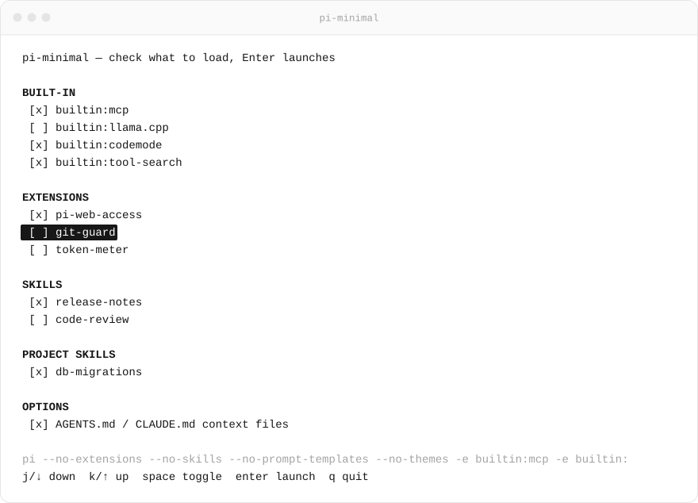

<p align="center">
  <picture>
    <source media="(prefers-color-scheme: dark)" srcset="https://raw.githubusercontent.com/nol166/pi-minimal/main/assets/hero-dark.svg">
    
  </picture>
</p>

<p align="center">
  Start <a href="https://github.com/earendil-works/pi">pi</a> with only the extensions and skills you pick.
</p>

<p align="center">
  <a href="#install">Install</a> ·
  <a href="#usage">Usage</a> ·
  <a href="docs/discovery.md">How it works</a>
</p>

<br>

<p align="center">
  <picture>
    <source media="(prefers-color-scheme: dark)" srcset="https://raw.githubusercontent.com/nol166/pi-minimal/main/assets/screen-dark.svg">
    
  </picture>
</p>

<br>

pi loads everything it can find: every extension, every skill, every package's resources, your context files. Each one costs context, and most sessions need only a few.

pi-minimal lists all of it on one screen. Tick what this session needs and press Enter: pi starts with exactly that, and nothing else.

- **Nothing is changed.** Your pi settings are never written. A plain `pi` afterwards behaves exactly as before.
- **What you see is what runs.** The bottom line is the exact `pi` command, updated as you toggle.
- **It matches pi.** Discovery follows pi's own rules (packages, settings filters, project resources), and CI checks it against pi's resolver.
- **Your picks are remembered.** The next launch starts from your last selection.

## Install

Needs [pi](https://github.com/earendil-works/pi), Python 3.10+ and [uv](https://docs.astral.sh/uv/). macOS and Linux.

```sh
uv tool install git+https://github.com/nol166/pi-minimal
```

Or try it without installing: `uvx --from git+https://github.com/nol166/pi-minimal pi-minimal`

## Usage

```sh
pi-minimal          # pick, then launch pi
pi-minimal --list   # print every item and the command that would run
```

| Key | |
| --- | --- |
| `j` `k` / `↑` `↓` | move |
| `space` | toggle |
| `enter` | save and launch pi |
| `q` | save and quit |

Run it from a project directory to see that project's skills, extensions and settings too.

## Configuration

| | |
| --- | --- |
| `~/.config/pi-minimal/selections.json` | your saved picks ([format](docs/discovery.md#selections-file)) |
| `~/.config/pi-minimal/config.json` | `{"default_checked": [...]}`: items ticked before your first launch |
| `PI_CODING_AGENT_DIR` | pi's agent directory (default `~/.pi/agent`), passed on to pi |
| `PI_MINIMAL_STATE` | a different selections file |

Running pi inside herdr? Put `herdr-agent-state` in `default_checked`, or herdr can't see when pi is working.

## Development

```sh
git clone https://github.com/nol166/pi-minimal && cd pi-minimal
uv run pi_minimal.py              # run from source
python3 tests/test_project_skills.py
python3 tests/test_pi_parity.py   # diff against the installed pi's resolver (needs node)
```

No dependencies beyond the standard library. `python3 assets/build.py` redraws the README graphics.
